# Cadena de Frío IoT — ESP32 + AWS

Sistema académico de monitoreo de temperatura y humedad para una cadena de frío de vacunas y medicamentos. Integra una ESP32 con sensor DHT22, comunicación MQTT sobre TLS, almacenamiento en Amazon DynamoDB, dashboard web y control remoto autenticado de un LED.

**Dashboard publicado (HTTPS):** https://main.d37dikjh3i2xsi.amplifyapp.com/

> **Alcance:** prototipo académico. No es un equipo médico certificado ni debe utilizarse para tomar decisiones reales sobre conservación de vacunas o medicamentos.

## 1. Caso de uso y objetivo

Se propone supervisar una caja o espacio de almacenamiento de vacunas y medicamentos que requiere mantener la temperatura entre **2 °C y 8 °C**. La ESP32 mide temperatura y humedad cada cinco segundos. Cuando la temperatura está por fuera de ese intervalo, la lectura se marca como alerta y se presenta en el dashboard.

El dashboard permite consultar las mediciones almacenadas y, mediante inicio de sesión, solicitar el encendido o apagado del LED integrado de la ESP32.

## 2. Funcionalidades implementadas

- Lectura de temperatura y humedad mediante sensor **DHT22**, conectado al GPIO 4.
- Envío de datos cada **5 segundos** desde la ESP32 a **AWS IoT Core** mediante MQTT sobre TLS y certificados X.509.
- Publicación de mediciones en el tópico `cadena-frio/datos`.
- Almacenamiento de las mediciones en **Amazon DynamoDB**, tabla `CadenaFrio-Lecturas`.
- Consulta de las **50 lecturas más recientes** mediante una función AWS Lambda.
- Dashboard con indicadores, alertas por temperatura, gráfica histórica, tabla de lecturas y descarga CSV.
- Inicio de sesión mediante **Amazon Cognito**, usando OAuth 2.0 Authorization Code con PKCE.
- Solicitudes de control a través de **Amazon API Gateway**, protegidas con un autorizador JWT.
- Envío de comandos `ON` y `OFF` al tópico MQTT `cadena-frio/control`.
- Recepción de los comandos en la ESP32 y control del LED integrado conectado al GPIO 2.
- Publicación del dashboard mediante **AWS Amplify Hosting**, con dirección HTTPS. Los archivos estáticos también se almacenaron en Amazon S3.

## 3. Arquitectura del sistema

### 3.1. Monitoreo y almacenamiento

```text
DHT22 (GPIO 4)
      |
      v
ESP32 -- MQTT/TLS --> AWS IoT Core
                           |
                           v
                    Regla de IoT Core
                           |
                           v
                  Amazon DynamoDB
                           |
                           v
                 AWS Lambda (lecturas)
                           |
                           v
               URL pública de Lambda
                           |
                           v
                Dashboard web (Amplify)
```

### 3.2. Control remoto autenticado

```text
Usuario
  |
  v
Dashboard HTTPS (Amplify)
  |                         Cognito emite el token
  +---- inicio de sesión ----------------> Amazon Cognito
  |                                             |
  |<--------------- token JWT ------------------+
  |
  v
API Gateway (POST /control)
  |
  +---- autorizador JWT valida el token
  |
  v
AWS Lambda (control)
  |
  v
AWS IoT Core: cadena-frio/control
  |
  v
ESP32 (suscrita al tópico)
  |
  v
LED integrado (GPIO 2)
```

### 3.3. Diagrama general de arquitectura

El siguiente diagrama reúne el flujo de monitoreo, almacenamiento, consulta y control remoto. Se incluye como diagrama Mermaid para que GitHub lo pueda representar directamente dentro de este README.

```mermaid
flowchart LR
    subgraph EXT["Componentes externos"]
        SENSOR["DHT22<br/>GPIO 4"]
        ESP["ESP32<br/>LED GPIO 2"]
        USER["Usuario<br/>Navegador"]
    end

    subgraph AWS["Servicios AWS — us-east-1"]
        IOT["AWS IoT Core<br/>MQTT / TLS"]
        RULE["Regla de AWS IoT"]
        DB[("Amazon DynamoDB<br/>CadenaFrio-Lecturas")]
        LREAD["Lambda de lecturas<br/>URL de consulta"]
        LCTRL["Lambda de control"]
        APIGW["API Gateway<br/>POST /control"]
        COG["Amazon Cognito<br/>OAuth 2.0 + PKCE"]
        AUTH["Autorizador JWT<br/>API Gateway"]
        S3["Amazon S3<br/>Archivos estáticos"]
        AMP["AWS Amplify Hosting<br/>Dashboard HTTPS"]
    end

    SENSOR -->|"Lecturas"| ESP
    ESP -->|"MQTT/TLS: cadena-frio/datos"| IOT
    IOT --> RULE
    RULE -->|"Inserta mediciones"| DB
    DB -->|"Consulta últimas 50"| LREAD
    LREAD -->|"JSON de lecturas"| AMP
    USER --> AMP

    USER -->|"Inicia sesión"| AMP
    AMP <-->|"Autenticación / token"| COG
    AMP -->|"POST /control + Bearer JWT"| APIGW
    APIGW --> AUTH
    COG -.->|"Emite JWT; claves públicas para validación"| AUTH
    AUTH -->|"Token válido"| LCTRL
    LCTRL -->|"Publica ON/OFF"| IOT
    IOT -->|"cadena-frio/control"| ESP
    ESP -->|"Acciona"| SENSOR

    S3 -.->|"Almacena copia de archivos web"| AMP

    classDef backend fill:#073b36,stroke:#10b981,color:#e5fff8
    classDef database fill:#2b1855,stroke:#a78bfa,color:#f3eaff
    classDef cloud fill:#38251b,stroke:#f59e0b,color:#fff4dc
    classDef external fill:#202c3d,stroke:#94a3b8,color:#eef5ff
    class IOT,RULE,LREAD,LCTRL backend
    class DB database
    class APIGW,COG,AUTH,S3,AMP cloud
    class SENSOR,ESP,USER external
```



**Cómo interpretar el diagrama:**

- **Monitoreo:** el DHT22 entrega las mediciones a la ESP32; esta las publica por MQTT/TLS en AWS IoT Core. Una regla de IoT Core las inserta en DynamoDB. La Lambda de lecturas consulta los últimos 50 registros y los entrega al dashboard.
- **Control remoto:** el usuario inicia sesión en Cognito desde el dashboard. Cognito emite un JWT; API Gateway valida ese token mediante su autorizador JWT antes de invocar la Lambda de control. La Lambda publica el comando en el tópico MQTT de control y la ESP32 lo recibe para accionar el LED.
- **Publicación web:** Amplify Hosting entrega el dashboard mediante HTTPS. Amazon S3 almacena los archivos estáticos que se cargaron para la práctica.

**Importante:** Cognito emite los tokens; quien valida el JWT en cada solicitud protegida es el autorizador de API Gateway. Una respuesta exitosa de la API confirma que el backend publicó el comando en AWS IoT Core, pero no constituye por sí sola una confirmación física del LED. La ejecución se verificó observando el LED y los mensajes del Monitor Serie de la ESP32.

## 4. Estructura del repositorio

```text
cadena-frio-iot-aws/
├── dashboard/
│   ├── index.html
│   ├── style.css
│   ├── app.js
│   └── auth-control.js
├── esp32/
│   ├── sketch_nov4a.ino
│   ├── secrets.example.h
│   └── certificados.example.h
├── lambda/
│   ├── CadenaFrio_LecturasPublicas.py
│   └── CadenaFrio_API.py
├── .gitignore
└── README.md
```

### Descripción de los archivos

| Archivo | Función |
|---|---|
| `dashboard/index.html` | Estructura de la interfaz web. |
| `dashboard/style.css` | Estilos y diseño adaptable del dashboard. |
| `dashboard/app.js` | Consulta de lecturas, actualización de indicadores, gráfica, tabla y exportación CSV. |
| `dashboard/auth-control.js` | Inicio/cierre de sesión con Cognito, PKCE y envío autenticado de comandos ON/OFF. |
| `esp32/sketch_nov4a.ino` | Firmware de la ESP32: conexión Wi-Fi, MQTT/TLS, DHT22 y recepción de comandos. |
| `esp32/secrets.example.h` | Plantilla de configuración Wi-Fi, endpoint y tópicos. |
| `esp32/certificados.example.h` | Plantilla de certificados TLS del dispositivo. |
| `lambda/CadenaFrio_LecturasPublicas.py` | Consulta de las últimas 50 lecturas de DynamoDB para el dashboard. |
| `lambda/CadenaFrio_API.py` | Consulta de lecturas y publicación de comandos MQTT para el control remoto. |
| `.gitignore` | Excluye credenciales, certificados privados y archivos locales. |

## 5. Materiales y herramientas

### Hardware
- Placa ESP32 compatible con Arduino.
- Sensor DHT22.
- Cables de conexión y alimentación USB.
- LED integrado de la placa, asociado al GPIO 2 en el montaje utilizado.

### Software y servicios
- Arduino IDE y soporte de placas ESP32.
- Bibliotecas Arduino: `WiFi`, `WiFiClientSecure`, `PubSubClient` y `DHT sensor library`.
- AWS IoT Core, AWS Lambda, Amazon DynamoDB, Amazon Cognito, Amazon API Gateway, Amazon S3 y AWS Amplify Hosting.
- Navegador web y cuenta de GitHub.

## 6. Procedimiento de desarrollo y configuración

### 6.1. Preparar y conectar la ESP32

1. Instalar Arduino IDE y agregar el soporte de la placa ESP32.
2. Instalar las bibliotecas `PubSubClient` y `DHT sensor library`. Las bibliotecas `WiFi` y `WiFiClientSecure` se incluyen con el entorno de ESP32.
3. Conectar el DHT22 al GPIO 4, alimentación y GND, respetando el esquema del módulo utilizado.
4. Utilizar el LED integrado de la placa, configurado en el firmware mediante `LED_PIN 2`.
5. En el repositorio, copiar `esp32/secrets.example.h` como `secrets.h` y completar localmente el SSID, contraseña Wi-Fi, endpoint de AWS IoT Core, puerto 8883, identificador MQTT y tópicos.
6. Copiar `esp32/certificados.example.h` como `certificados.h` y completar localmente el certificado raíz de Amazon, certificado del dispositivo y clave privada.
7. Abrir `esp32/sketch_nov4a.ino`, seleccionar la placa y puerto correctos y cargar el programa.
8. Abrir el Monitor Serie a **115200 baudios**. Verificar conexión Wi-Fi, conexión MQTT, suscripción al tópico de control y publicación periódica de las mediciones.

El firmware utiliza `USAR_SENSOR = true` y un intervalo de 5000 ms. La opción de simulación está disponible en el código, pero las pruebas funcionales reportadas se realizaron con el sensor DHT22.

### 6.2. Configurar AWS IoT Core

1. Seleccionar la región de trabajo `us-east-1`.
2. Crear un objeto (Thing) para identificar la ESP32.
3. Crear y activar un certificado X.509 para el dispositivo.
4. Descargar y guardar localmente el certificado, la clave privada y el certificado raíz correspondiente.
5. Crear y asociar una política IoT de permisos mínimos para que el dispositivo pueda conectarse, publicar datos y suscribirse/recibir mensajes de control.
6. Copiar el endpoint de datos de AWS IoT Core en `secrets.h`.
7. Utilizar los tópicos:
   - Datos: `cadena-frio/datos`.
   - Control: `cadena-frio/control`.
8. Confirmar desde AWS IoT Core que el dispositivo se conecta y que se reciben publicaciones.

### 6.3. Almacenar las mediciones en DynamoDB

1. Crear la tabla `CadenaFrio-Lecturas` en DynamoDB.
2. Configurar la clave de partición `deviceId` y la clave de ordenamiento `timestamp`, de acuerdo con el código de consulta.
3. Crear una regla de AWS IoT Core que procese los mensajes publicados en `cadena-frio/datos`.
4. Configurar la acción de la regla para insertar las mediciones en DynamoDB, incluyendo el identificador `ESP32-CadenaFrio`, la marca de tiempo, temperatura, humedad y estado de alerta.
5. Asignar a la regla un rol IAM con permiso para insertar elementos en la tabla.
6. Verificar que los elementos aparezcan en DynamoDB y que sus valores correspondan a los publicados por la ESP32.

### 6.4. Configurar la función Lambda de consulta

1. Crear una función Lambda para ejecutar el archivo `lambda/CadenaFrio_LecturasPublicas.py`.
2. Configurar el entorno para Python y los permisos IAM de lectura sobre `CadenaFrio-Lecturas`.
3. Verificar que la función consulte la tabla por el dispositivo `ESP32-CadenaFrio`.
4. Configurar la función para devolver las 50 lecturas más recientes en formato JSON.
5. Habilitar una URL de función para la consulta pública de solo lectura y configurar CORS para el origen del dashboard.
6. Copiar la URL de la función en la constante `READINGS_API_URL` de `dashboard/app.js`.
7. Probar la URL y comprobar que devuelve las mediciones guardadas.

### 6.5. Configurar el control remoto mediante Lambda y API Gateway

1. Crear la función Lambda de control utilizando `lambda/CadenaFrio_API.py`.
2. Asignar a su rol IAM permiso para publicar mensajes en el tópico `cadena-frio/control` de AWS IoT Core.
3. Revisar en el código la región, nombre de la tabla, endpoint IoT y tópico de control.
4. Crear una HTTP API en Amazon API Gateway.
5. Crear la ruta `POST /control` e integrarla con la Lambda de control.
6. Configurar un autorizador JWT asociado al User Pool de Cognito y al cliente de aplicación.
7. Configurar CORS para el origen HTTPS de Amplify, permitiendo el método POST y los encabezados `authorization` y `content-type`.
8. Desplegar la API y copiar la URL de invocación en la constante `CONTROL_API` de `dashboard/auth-control.js`.
9. Probar que las solicitudes sin token válido sean rechazadas y que las solicitudes autenticadas puedan publicar los comandos `ON` y `OFF`.

### 6.6. Configurar Amazon Cognito

1. Crear un User Pool para administrar los usuarios autorizados.
2. Crear un cliente de aplicación público, sin secreto de cliente, para la aplicación web.
3. Configurar el inicio de sesión con código de autorización OAuth 2.0 y PKCE.
4. Configurar los ámbitos OpenID requeridos por la aplicación.
5. Registrar las URL de retorno autorizadas:
   - `http://localhost:5500/` para pruebas locales.
   - `https://main.d37dikjh3i2xsi.amplifyapp.com/` para la versión publicada.
6. Configurar el dominio de Cognito.
7. Crear los usuarios autorizados desde la administración del User Pool, según la política de acceso definida para la práctica.
8. Actualizar `COGNITO_DOMAIN`, `CLIENT_ID` y `REDIRECT_URI` en `dashboard/auth-control.js`.
9. Iniciar sesión desde el dashboard HTTPS y comprobar que los botones de control se habiliten después de autenticarse.

**Seguridad:** no publicar contraseñas, tokens, claves privadas ni certificados del dispositivo. El identificador del cliente SPA y las URL de servicios utilizadas por el navegador no son secretos. El control debe permanecer protegido por el autorizador JWT de API Gateway; CORS por sí solo no autentica usuarios.

### 6.7. Configurar y desplegar el dashboard

1. Revisar los cuatro archivos de la carpeta `dashboard/`.
2. Configurar la URL de consulta de lecturas en `dashboard/app.js`.
3. Configurar los datos públicos de Cognito y la URL de control en `dashboard/auth-control.js`.
4. Probar localmente la interfaz con un servidor web local. Para el flujo de Cognito local se registró `http://localhost:5500/` como URL de retorno de pruebas.
5. Subir los archivos estáticos del dashboard a Amazon S3. El bucket utilizado en la práctica es `cadena-frio-iot-dashboard-2026`; se organizó una copia de los archivos en el prefijo `sitio-amplify/`.
6. Publicar la versión HTTPS mediante AWS Amplify Hosting. La rama de producción utilizada es `main`.
7. Abrir la URL publicada y comprobar que carga el dashboard, consulta DynamoDB y permite iniciar sesión.
8. Probar el encendido y apagado remoto del LED desde la versión publicada.

**Justificación de Amplify:** se utilizó AWS Amplify Hosting para disponer de una dirección HTTPS administrada para la aplicación web y facilitar su publicación. Esto permite utilizar el flujo de autenticación de Cognito en producción con una URL de retorno HTTPS. La dirección HTTP de alojamiento web estático de S3 no sustituye por sí sola el endpoint HTTPS de producción.

## 7. Pruebas y validación realizadas

- **Conectividad:** la ESP32 se conectó a Wi-Fi y a AWS IoT Core mediante MQTT/TLS.
- **Adquisición:** se recibieron lecturas reales de temperatura y humedad del DHT22.
- **Almacenamiento:** se verificó la llegada de registros a la tabla DynamoDB.
- **Dashboard:** se visualizaron indicadores, alertas, gráfica histórica y tabla de lecturas.
- **Autenticación:** se inició sesión desde la URL HTTPS publicada mediante Cognito.
- **Control remoto:** se enviaron comandos ON y OFF desde el dashboard y se comprobó el encendido y apagado físico del LED integrado.
- **Exportación:** se verificó la descarga de lecturas en formato CSV.

## 8. Limitaciones conocidas

- La consulta implementada en las funciones Lambda utiliza `Limit=50`; por tanto, el dashboard y el CSV descargan como máximo las **50 lecturas más recientes** que devuelve la API. No representa una exportación histórica completa de toda la tabla.
- El dashboard actualiza la consulta periódicamente y muestra los datos disponibles en DynamoDB.
- El envío de un comando a AWS no confirma por sí mismo la ejecución física; la verificación se realiza en la ESP32.
- El rango de 2 °C a 8 °C es un umbral configurado para la demostración académica, no una certificación del sistema de conservación.

## 9. Seguridad y archivos que no deben publicarse

Los archivos reales `secrets.h` y `certificados.h` deben existir únicamente en el entorno local de desarrollo de la ESP32. El repositorio incluye las plantillas `secrets.example.h` y `certificados.example.h`, no las credenciales reales.

El archivo `.gitignore` excluye estos archivos y otros elementos sensibles. Antes de compartir el repositorio, revisar que no se hayan agregado contraseñas Wi-Fi, certificados de dispositivo, claves privadas, tokens ni credenciales AWS.

## 10. Reproducción del proyecto

Para reproducir la práctica desde cero:

1. Clonar el repositorio.
2. Preparar la ESP32 y completar localmente los archivos de configuración y certificados.
3. Crear los recursos de AWS IoT Core y DynamoDB.
4. Desplegar las funciones Lambda y configurar sus permisos IAM.
5. Configurar Cognito y API Gateway para el control autenticado.
6. Configurar las URL del frontend.
7. Publicar los archivos del dashboard en S3 y Amplify.
8. Encender la ESP32 y verificar el flujo completo de medición, almacenamiento, visualización y control.

---

**Repositorio:** https://github.com/JfLopez1109/cadena-frio-iot-aws  
**Dashboard:** https://main.d37dikjh3i2xsi.amplifyapp.com/  
**Región AWS utilizada:** `us-east-1`
